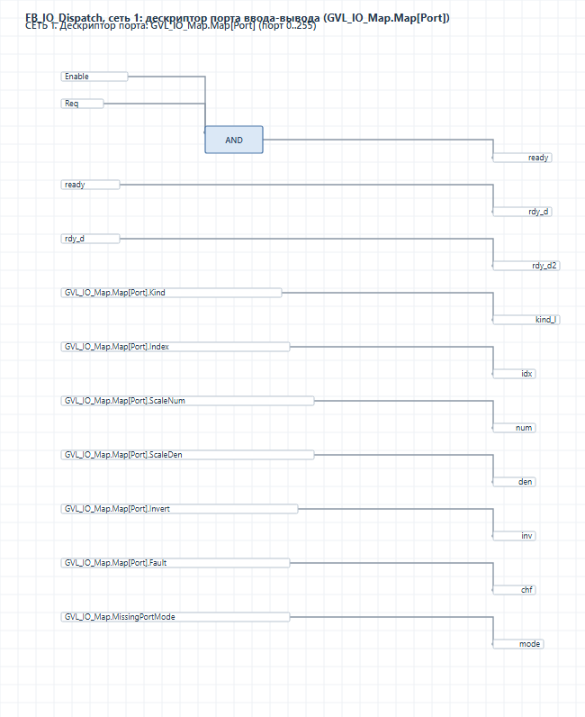
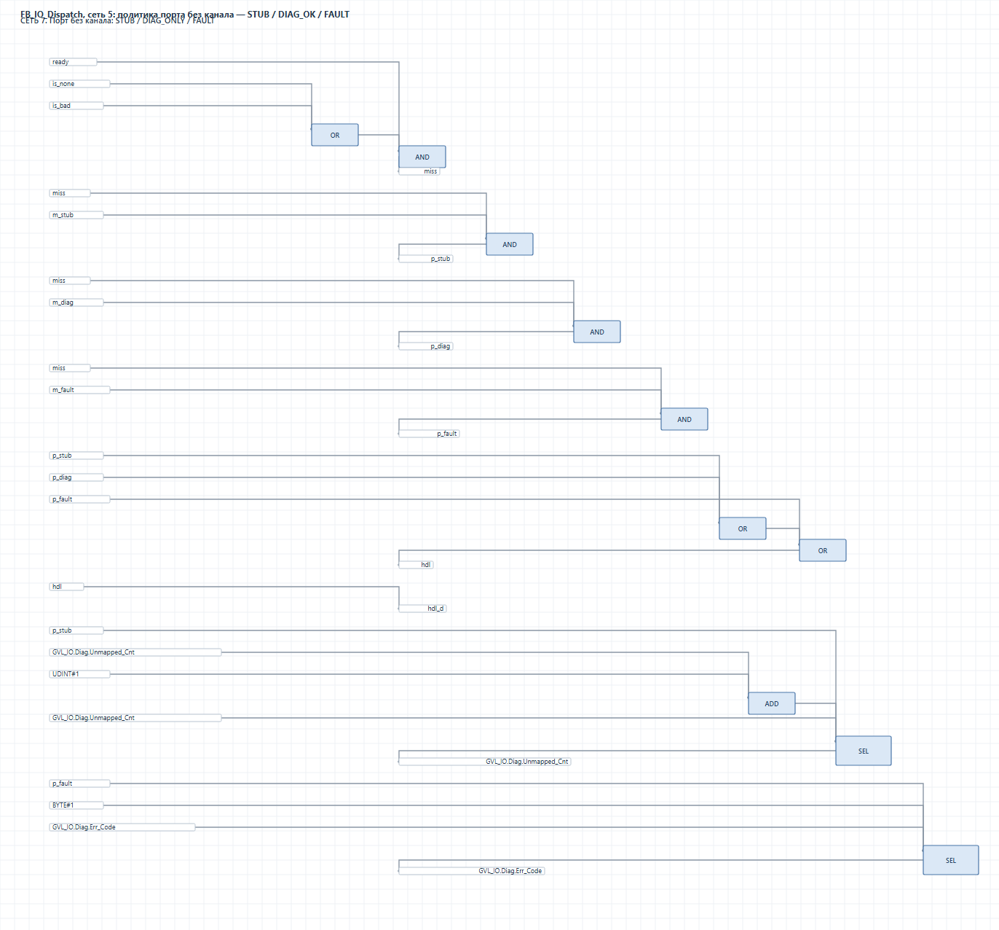
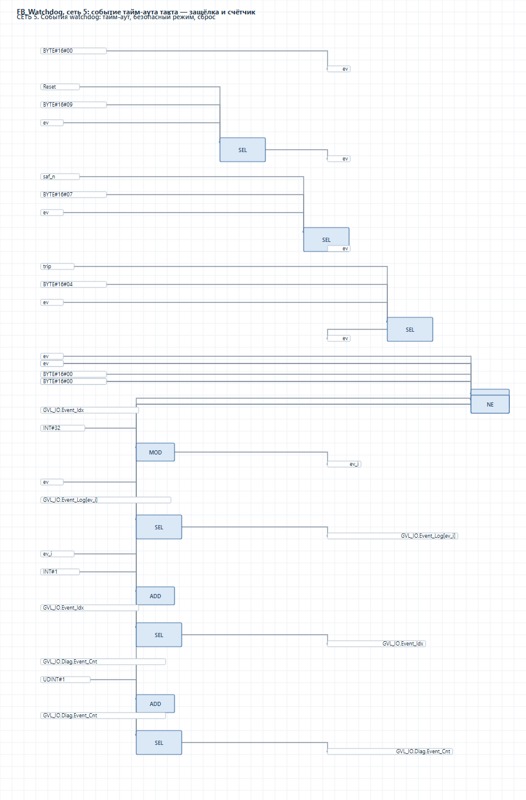
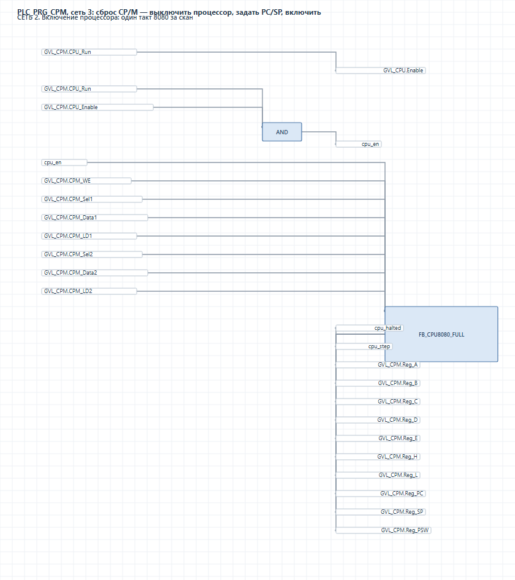
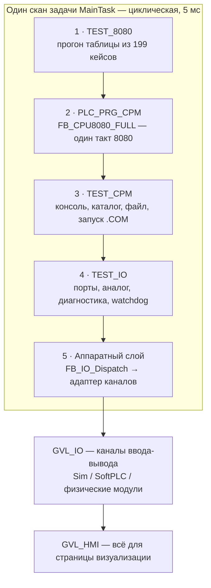
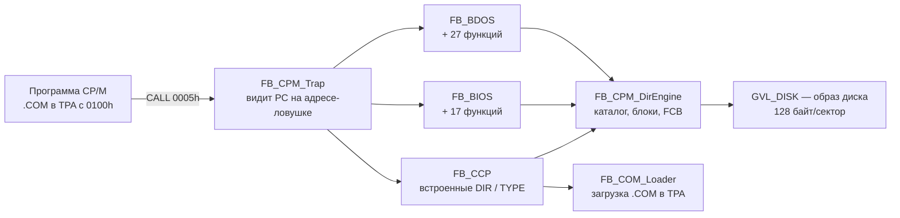

<div align="center">

# Intel 8080 + CP/M 2.2 — целиком на FBD в CODESYS 3.5

**Эмулятор процессора, операционная система и промышленный ввод-вывод, нарисованные релейными схемами ПЛК.**
Ни одной строки ST в логике. Ни одной готовой библиотеки. 218 тестов: 199/199 ядра и 10/10 ввода-вывода подтверждены прогоном, слой CP/M — в работе, см. врезку о статусе.

[](https://www.codesys.com/)
[](#жёсткие-ограничения-проекта)
[](#результаты-проверено-прогоном)
[](#масштаб)
[](LICENSE)

<sub>Русский — основной язык репозитория · English summary below</sub>

</div>

---

## English summary

A complete **Intel 8080 CPU emulator**, a **CP/M 2.2 operating system layer** (BIOS / BDOS / CCP, real `.COM` loading)
and a **PLC hardware I/O layer**, implemented **entirely in FBD function-block diagrams inside CODESYS V3.5 SP17 Patch 3** —
no structured text for logic, no ready-made emulator libraries, no CFC. Every POU is generated from Python via
PLCopenXML (`generator/`), one 8080 machine cycle equals one PLC scan, and the whole system is verified by
**218 automated tests (199 core + 9 CP/M + 10 I/O)** in the CODESYS simulator: **199/199 core and 10/10 I/O verified**, `0 errors, 0 warnings`,
5 255 FBD blocks, 16 606 connections, 0 unconnected inputs.

The repository also documents **43 classes of real defects** found while generating FBD from PLCopenXML and the
debugging methodology behind them (`docs/10_ОШИБКИ_И_РЕШЕНИЯ.md`) — useful for anyone building Z80/6502 or any
other emulator on a PLC.

Licensed under **CC BY 4.0**. CODESYS is a trademark of CODESYS GmbH; Intel 8080 and CP/M are the property of their
respective owners. This project is not affiliated with them.

---

## Что это

Проект отвечает на вопрос, который обычно считают риторическим: **можно ли написать компьютер внутри ПЛК, пользуясь
только языком релейных схем?**

На типовом ПЛК логика пишется по стандарту МЭК 61131-3. Язык **FBD** (Function Block Diagram) — это графика из
блоков и проводов, ближайший родственник релейно-контактных схем. На нём принято делать межблочные блокировки, ПИД-регуляторы
и обработку аварий — но не процессоры. Здесь на FBD сделано всё:

| Слой | Что реализовано | Как |
|---|---|---|
| **Процессор** | Полный набор документированных команд Intel 8080, регистры A–L, PC, SP, флаги S/Z/AC/P/CY, память 64 КБ, прерывания | `FB_CPU8080_FULL` — 10 фаз такта, 10 отдельных декодеров, АЛУ на 8 бит |
| **Операционная система** | CP/M 2.2: BIOS (17 функций), BDOS (27 функций), CCP, FCB, каталог, дисковый образ, загрузка и запуск настоящих `.COM` | Метод HLE: в эмулируемой памяти лежат настоящие `JMP`-ловушки, логика — в схемах |
| **Ввод-вывод** | Порты `IN`/`OUT`, дискретные и аналоговые каналы, масштабирование, политика отсутствующего порта, watchdog, HMI-слой | `FB_IO_Dispatch` + сменный адаптер: симуляция / SoftPLC / реальные модули `%IB/%QB/%IW/%QW` |
| **Тесты** | 218 кейсов, прогоняемых внутри ПЛК как часть задачи | Табличный прогон в FBD; данные кейсов — массив структур (ST разрешён только для данных) |

Ключевая идея проекта: **один такт 8080 = один скан ПЛК**. Процессор не «вызывается в цикле» — он живёт в
расписании задачи, а порядок фаз такта обеспечивается порядком вызовов программ в конфигурации задач CODESYS.

> Проект вырос из двух технических заданий: (ТЗ-1) эмулятор 8080 на FBD и (ТЗ-2) настоящая CP/M 2.2 с аппаратной
> обвязкой. Ограничения задания были жёсткими и соблюдены буквально — см. [«Жёсткие ограничения»](#жёсткие-ограничения-проекта).

---

## Результаты (проверено прогоном)

Сборка `EMU8080_STAGE4.project`, компиляция **0 ошибок, 0 предупреждений** («готово к загрузке»), прогон в
симуляции CODESYS (`start()` → `ApplicationState.run`), отчёт [`docs/14_РЕЗУЛЬТАТЫ_ТЕСТОВ.md`](docs/14_РЕЗУЛЬТАТЫ_ТЕСТОВ.md).

> **Честная оговорка (06.11.2026).** Проверка перед сдачей подтвердила **ядро 8080 (199/199)** и **ввод-вывод (10/10)**
> повторной сборкой и прогоном. Цифра **8/8 по CP/M получена по счётчику, а не по содержимому вывода**: дамп журнала
> консоли — `\r\nA>.` подряд, то есть CCP принимает `CR` каждый цикл и выполняет пустые команды, а проверки 1, 2, 4, 5, 6
> сравнивают длину журнала. Открытый дефект и план его закрытия — в
> [`docs/15_ПРОВЕРКА_ПЕРЕД_СДАЧЕЙ.md`](docs/15_ПРОВЕРКА_ПЕРЕД_СДАЧЕЙ.md).

| Набор | Всего | PASS | FAIL |
|---|---:|:---:|:---:|
| Ядро Intel 8080 — `TEST_8080` | 199 | **199** | 0 |
| Слой CP/M 2.2 — `TEST_CPM` | 9 | 8 | 0 |
| Аппаратный ввод-вывод — `TEST_IO` | 10 | **10** | 0 |

Что именно доказано этими тестами:

* **Команды.** Все группы: `MOV` (64 комбинации регистров, включая `M` по `HL`), `MVI`, `INR`/`DCR`, переходы
  (`JMP`, `JZ`, `JNZ`, `JC`, `JNC`, `JP`, `JM`, `JPE`, `JPO`, `CALL`, `RET`, `RST`, `PUSH`/`POP`, `XTHL`, `PCHL`,
  `SPHL`), загрузка/сохранение (`LDA`, `STA`, `LDAX`, `STAX`, `LHLD`, `SHLD`, `XCHG`), арифметика (`ADD`, `ADC`,
  `ADI`, `ACI`, `SUB`, `SBB`, `SUI`, `SBI`, `DAD`), логика и флаги (`ANA`, `ANI`, `ORA`, `ORI`, `XRA`, `XRI`, `CMP`,
  `CPI`, `STC`, `CMC`, `CMA`, `DAA`, `RLC`, `RRC`, `RAL`, `RAR`, `NOP`, `HLT`, `EI`, `DI`).
* **CP/M.** Подтверждено: CCP запускается, печатает приглашение `A>`, счётчики команд и ловушек работают. 
  **Не подтверждено:** эхо и вывод `DIR`/`TYPE`, содержимое `README.TXT` и запуск настоящей `.COM` — 
  дамп журнала показывает только `A>` (открытый дефект, см. [15_ПРОВЕРКА_ПЕРЕД_СДАЧЕЙ.md](docs/15_ПРОВЕРКА_ПЕРЕД_СДАЧЕЙ.md)).
* **Ввод-вывод.** `OUT 00h` → `DO[0]`; `IN 10h` → `01h`; канал с инверсией; масштаб аналога `27648 → 255` и обратно;
  порт без канала в режимах `STUB` и `FAULT`; `IN` **через процессор** (механизм wait state); тайм-аут watchdog.

Параметры одного из прогонов: 15 667 сканов задачи, 8 786 тактов 8080, 602 срабатывания ловушек CP/M,
610 знаков в журнале консоли CP/M, первая ошибка — отсутствует.

### Масштаб

| Показатель | Значение |
|---|---|
| POU прикладного слоя (CP/M, I/O, тесты, HMI) | 68 |
| POU-зависимостей ядра 8080 | 27 |
| Блоков FBD в собираемом проекте | ≈ 5 255 |
| Связей, проверенных валидатором | 16 606 (пустых входов — **0**) |
| Описано классов дефектов генерации/импорта | 43 |

---

## Как выглядит схема

Это не макеты: **картинки отрисованы из тех же сгенерированных PLCopenXML, что лежат в репозитории** —
скриптом [`tools/render_fbd.py`](tools/render_fbd.py) (Python, без CODESYS и сторонних библиотек).
Блоки, их координаты и связи взяты из файлов `src/s4_pous/*.plcopenxml`.

**Дескриптор порта ввода-вывода** — `FB_IO_Dispatch`, сеть 1: по номеру порта из `GVL_IO_Map.Map[Port]`
выбираются тип канала, инверсия, масштаб и режим отсутствующего канала:



**Политика порта без канала** — `FB_IO_Dispatch`, сеть 5: `STUB` / `DIAG_OK` / `FAULT`, диагностика и счётчики:



**Watchdog такта** — `FB_Watchdog`, сеть 5: событие тайм-аута, защёлка и счётчик:



**Сброс CP/M** — `PLC_PRG_CPM`, сеть 3: процессор выключается, выставляются `PC`/`SP`, затем включается —
правило «старт системы: выключить процессор → задать PC/SP → включить»:



Пересоздать картинки (после изменения схем и сборки):

```powershell
cd tools
python render_fbd.py ..\src\s4_pous\FB_IO_Dispatch.plcopenxml 0 ..\docs\images\img_fb_io_dispatch_port.svg --title "FB_IO_Dispatch, сеть 1: дескриптор порта"
```

> Полный вид всех 124 сетей задаётся параметром `all` вместо номера сети. Скриншот из самого редактора CODESYS
> в репозиторий не входит: картинку POU в SP17 отдаёт только внутренний компонент редактора (`POUImage.dll`,
> в скриптовый API не входит), поэтому снимок возможен лишь вручную из GUI.

---

## Как это устроено



Порядок вызовов программ в задаче — **часть схемы, а не формальность**: тест, который пишет регистры через порт
доступа CP/M, обязан попасть в процессор *до* того, как программа вызовет процессор, иначе запись применится сканом позже.

### Такт 8080 = скан ПЛК: 10 фаз внутри одного блока

`FB_CPU8080_FULL` разложен на 10 сетей сверху вниз — **порядок сетей и есть порядок выполнения**:

| Фаза | Что происходит |
|---|---|
| 0 | **Прерывание** — `FB_Interrupt`: если `Int_Req` и `IFF` и такт свободен, PC идёт в стек, `PC := вектор*8`, `IFF := 0` |
| 1 | **Выборка** — адрес PC на шину, чтение команды в IR |
| 2 | **Декодирование** — `FB_Decoder_Full` заполняет управляющее слово `GVL_CPU` |
| 3 | **Адреса** — `PC+1`, `PC+2`, `SP±1`, `SP±2`, пары `HL`/`DE`/`BC` |
| 4 | **Чтение** — 6 экземпляров `FB_Memory64K`: команда, операнд `M` по `HL`, байты по `PC+1`/`PC+2`, операнд по адресу и по адресу+1 |
| 5 | **Операнды** — MUX регистра-источника, выбор «регистр / память / непосредственное» |
| 6 | **АЛУ** — `FB_ALU8`, `FB_Rotate8`, `FB_DAA`, выравнивание флагов |
| 7 | **Результат** — единый `res8/res8b` и данные двух портов записи в память |
| 8 | **Управление** — `FB_CtrlUnit`: условие перехода, адрес перехода, SP, `IFF`/`Busy` |
| 9 | **Запись** — память (2 экземпляра), регистровый файл, флаги, PC, SP |
| 10 | **Служебное** — `HLT` и счётчик тактов |

Кодировка 8080 декодируется по структуре `биты 7..6` (группа: расширенная / MOV / АЛУ / управление и стек) —
десять декодеров покрывают все документированные опкоды: `FB_DecodeFull_MOV`, `_MVI`, `_ALU`, `_ALUI`, `_DATA`,
`_JMP`, `_STACK`, `_SPEC`, `_HLT` и сводный `FB_Decoder_Full`.

### Слой CP/M: настоящая ОС без ассемблера
### Слой CP/M: настоящая ОС без ассемблера (статус проверки — врезка ниже)
> **ввод команд с консоли в CCP не работает**: CCP принимает `CR` каждый цикл и выполняет пустые команды,
> вывод `DIR`/`TYPE` и запуск `.COM` в журнале не наблюдались. Подробности, что уже пробовалось и план —
> [`docs/15_ПРОВЕРКА_ПЕРЕД_СДАЧЕЙ.md`](docs/15_ПРОВЕРКА_ПЕРЕД_СДАЧЕЙ.md).


Ассемблера 8080 в системе нет, исходников CP/M тоже. Поэтому применён метод **HLE (high level emulation)**:



* В эмулируемой памяти по адресам CP/M лежат **настоящие команды перехода**: `0000h: JMP 0E003h` (RST 0 → WBOOT),
  `0005h/0008h: JMP 0F000h` (точка входа BDOS), таблица `0E000h` — 17 записей по 3 байта (BIOS).
* Программа работает как обычно: `CALL 0005h` попадает на `JMP`, процессор его выполняет, PC оказывается на
  адресе-ловушке — и там включается `FB_CPM_Trap`: останавливает процессор, снимает адрес возврата со стека, отдаёт
  управление диспетчеру BDOS/BIOS/CCP и после квитанции возвращает регистры (`A`, `H`, `L`, `PC`, `SP`).
* **Циклов в FBD нет**, поэтому просмотр каталога идёт по одной записи за скан, а процессор в это время остановлен —
  ровно как в настоящем CP/M, где BDOS надолго занимает процессор.
* Формат диска настоящий: каталог `DRM+1` записей по 32 байта, блоки `128 << BSH` байт, битовая карта занятости,
  FCB 36 байт. Профили: **дискета 256 КБ** (`SPT=26, BSH=3, DSM=242, DRM=63`) и **жёсткий диск 8 МБ**
  (`SPT=128, BSH=5, DSM=2047, DRM=1023`) — оба прогнаны: результаты прогонов — в [15_ПРОВЕРКА_ПЕРЕД_СДАЧЕЙ.md](docs/15_ПРОВЕРКА_ПЕРЕД_СДАЧЕЙ.md).

На дисковом образе лежат **четыре настоящих файла**, собранных мини-ассемблером прямо в Python (`pou_demo.py`):

| Файл | Что делает |
|---|---|
| `HELLO.COM` | печатает строку через BDOS 9 и уходит в `WBOOT` |
| `DIR.COM` | обходит каталог через BDOS 17/18 (SEARCH FIRST/NEXT) — не встроенная команда, а настоящая программа |
| `TYPE.COM` | открывает файл по FCB из `005Ch`, читает записи до `1Ah` — то есть `TYPE README.TXT` |
| `README.TXT` | текст, который печатает `TYPE.COM` |

### Аппаратный ввод-вывод

`FB_IO_Dispatch` — карта портов: тип канала, инверсия, масштаб, политика для отсутствующего порта (`STUB` / `FAULT` /
`DIAG`), счётчики, журнал событий, квитанция процессору. `FB_IO_Adapter_Sim`, `FB_IO_Adapter_SoftPLC` и
`FB_IO_Adapter_HW` имеют **один интерфейс**, поэтому профиль меняется одной константой `ADAPTER_TYPE` — прикладной код
(ядро 8080, ловушки, главная программа) не меняется вообще.

Команда `IN`/`OUT` работает как обращение к медленному устройству (**wait state**, два скана), потому что аппаратный
слой обязан вызываться после процессора — иначе ломается уже проверенный порядок слоя CP/M.

---

## Быстрый старт

### Вариант 1 — открыть готовый проект (самый быстрый)

1. Установить **CODESYS V3.5 SP17 Patch 3** (более новые версии обычно тоже открывают проект, но проверялось на SP17).
2. Открыть [`build/EMU8080_STAGE4.project`](build/EMU8080_STAGE4.project).
3. `Устройство (Device.Sim)` → **Симуляция** → `Онлайн → Вход в систему` → `Пуск`.
4. Наблюдать результаты в `GVL_TEST` (`Pass_Cnt`, `Fail_Cnt`, `Done8080`, `DoneCpm`, `DoneIo`) и в журнале консоли
   CP/M `GVL_CPM.Con_Log`.

### Вариант 2 — пересобрать проект из генератора

Проект не рисуется руками: **все 68 POU генерируются из Python-скриптов в PLCopenXML и импортируются в CODESYS
headless-скриптом**. Это позволяет держать логику в тексте, ревьюить её как код и воспроизводить сборку.

Проверено на **чистом рабочем каталоге** (06.11.2026): команды ниже выполнены с нуля, проект собран, все тесты пройдены.
Генератор сам пересоздаёт 27 зависимостей ядра из своих модулей, поэтому внешний снимок зависимостей для сборки не нужен.

```powershell
# 1. рабочий корень (не в OneDrive: CODESYS не читает такие пути — см. docs/КОНСПЕКТЫ_ДЛЯ_КОЛЛЕГ/01)
cd generator\tools
.\setup_work.ps1                      # создаёт C:\dsh8080\work\emu_s4 и stage_s4, кладёт готовый проект как исходную точку

# 2. полный цикл: генерация XML -> импорт -> конфигурация задач -> компиляция -> онлайн-прогон -> отчёт
.\run_stage4.ps1 -Script ..\gen_stage4.py -MaxAttempts 8 -RunTimeoutSec 2700 -NoSrcCopy
```

Результат прогона: `log\gen_stage4.log` (ход сборки и цифры тестов) и `report\stage4_report.md`
(таблица «тест → ожидание → факт → PASS/FAIL» по 199 кейсам ядра + расшифровка и дамп журнала консоли CP/M).
Каталоги можно задать явно при своих путях: `.\setup_work.ps1 -WorkRoot D:\emu8080 -WithDeps`.

Требования: CODESYS 3.5 SP17 Patch 3 (скриптовый движок IronPython 2.7 встроенный), Windows, закрытые экземпляры
CODESYS (он однопроцессный), ~2 ГБ свободного места на рабочем диске, 8–30 минут на прогон (импорт 68 POU идёт
несколько минут — это нормально).

Проверки **без CODESYS** — они находят дефекты за секунды там, где сборка стоит минуты, и прогоняются ПЕРЕД сборкой:

```powershell
cd generator
python dryrun_stage4.py                  # сборка PLCopenXML локально, без CODESYS
python tools\check_xml.py                # структурная валидность PLCopenXML
python tools\check_pins.py               # все входы блоков подключены
python tools\check_types.py              # типы соединяемых выходов и входов
python tools\check_names.py              # имена против ключевых слов IEC и коллизий регистра
```

Отчёт прогона формируется автоматически: `report/stage4_report.md` — таблица «тест → ожидание → факт → PASS/FAIL»
по 199 кейсам ядра плюс расшифровка и дамп журнала консоли CP/M.

---

## Структура репозитория

```
8080_CODESYS_3.5/
├── README.md                     ← эта страница
├── LICENSE                       ← CC BY 4.0 (полный текст)
├── NOTICE.md                     ← атрибуция, товарные знаки, границы применимости
├── build/
│   └── EMU8080_STAGE4.project    ← готовый проект CODESYS: открыть и запустить
├── docs/                         ← 17 документов проекта (см. ниже) + картинки схем
│   └── КОНСПЕКТЫ_ДЛЯ_КОЛЛЕГ/     ← сжатый курс: окружение, диалект FBD, ошибки, отладка
├── generator/                    ← то, из чего всё собирается
│   ├── fbd_xml.py                ← генератор PLCopenXML: правила диалекта FBD
│   ├── pou_decode_full.py        ← 10 декодеров всех опкодов 8080
│   ├── pou_cpu_full.py           ← ядро: 10 фаз такта
│   ├── pou_cpm_defs.py           ← карта памяти CP/M, DUT, GVL, конструкторы FBD
│   ├── pou_bios.py / pou_bdos.py  ← 17 функций BIOS и 27 функций BDOS
│   ├── pou_ccp.py                ← CCP на схемах + запуск .COM
│   ├── pou_com_loader.py         ← загрузчик .COM в TPA
│   ├── pou_demo.py               ← мини-ассемблер 8080 + образ диска
│   ├── pou_io.py / pou_io_hw.py  ← аппаратный слой и сменные адаптеры
│   ├── pou_test8080.py           ← TEST_8080: 199 кейсов
│   ├── pou_testcpm.py            ← TEST_CPM: 9 проверок
│   ├── pou_testio.py             ← TEST_IO: 10 проверок
│   ├── gen_stage4.py             ← драйвер: сборка + задача + прогон + отчёт
│   ├── run_online.py             ← онлайн-сессия в симуляции, чтение значений, отчёт
│   └── tools/                    ← 44 инструмента: валидаторы, бисекция, раннеры
├── tools/render_fbd.py           ← рендер FBD-схемы из PLCopenXML в SVG (для README)
├── report/                       ← отчёты о прогонах
├── src/dep_fix/                  ← снимок 27 POU-зависимостей ядра (вход повторной сборки)
└── tests/                        ← где живут тесты и почему их не видно как .py
```

Сгенерированный PLCopenXML (`src/s4_pous/`, ~44 МБ) и журналы прогонов в репозиторий **не входят**: они полностью
пересоздаются генератором. Это осознанно — репозиторий должен оставаться читаемым, а не быть свалкой артефактов.

---

## Документация

Документация проекта — это ещё и «чужой опыт»: 43 класса реальных дефектов, которые проявлялись молча.
Если вы делаете Z80, 6502 или любой другой эмулятор на ПЛК — начинайте с этих четырёх документов.

| Документ | О чём |
|---|---|
| [**10_ОШИБКИ_И_РЕШЕНИЯ**](docs/10_ОШИБКИ_И_РЕШЕНИЯ.md) | Полный каталог **43 классов ошибок**: симптом → причина → как обнаружить → решение → перенос на Z80/6502 |
| [**11_МЕТОДИКА_ОТЛАДКИ**](docs/11_МЕТОДИКА_ОТЛАДКИ.md) | Как эти ошибки находились: защёлки, счётчики, метки сканов, цикл сборки, бисекция |
| [**12_ШАБЛОНЫ_FBD**](docs/12_ШАБЛОНЫ_FBD.md) | Готовые проверенные конструкции FBD: `SEL`, запись по константным индексам, регистровый файл, стек, переходы, такт |
| [**13_ЗАМЕТКИ_ДЛЯ_Z80_И_6502**](docs/13_ЗАМЕТКИ_ДЛЯ_Z80_И_6502.md) | Что переносится без изменений, что будет другим, оценка трудоёмкости |

| Документ | О чём |
|---|---|
| [00_ОГЛАВЛЕНИЕ](docs/00_ОГЛАВЛЕНИЕ.md) | Карта всей документации |
| [05_АЛГОРИТМ_РАБОТЫ](docs/05_АЛГОРИТМ_РАБОТЫ.md) | Порядок работы над проектом и правила, выведенные по ходу |
| [02_ПЛАН_ТЕСТИРОВАНИЯ](docs/02_ПЛАН_ТЕСТИРОВАНИЯ.md) | Тесты писались ДО работ: 199 кейсов ядра, CP/M, I/O |
| [04_ПЛАН_CPM](docs/04_ПЛАН_CPM.md) | Карта памяти, DPB, каталог, диспетчеры, ловушки |
| [03_ЖУРНАЛ_СБОРКИ](docs/03_ЖУРНАЛ_СБОРКИ.md) | Хроника сборки и разбора дефектов |
| [07_ПЛАН_ДОВОДКИ](docs/07_ПЛАН_ДОВОДКИ.md) | История доводки: 40 разделов с находками |
| [09_ПРОТОКОЛ_ПРОГОНА](docs/09_ПРОТОКОЛ_ПРОГОНА.md) | Протокол прогона: таблица результатов |
| [14_РЕЗУЛЬТАТЫ_ТЕСТОВ](docs/14_РЕЗУЛЬТАТЫ_ТЕСТОВ.md) | Результаты прогонов и честный список того, что не закрыто |
| [06_ЧТО_ОСТАЛОСЬ](docs/06_ЧТО_ОСТАЛОСЬ.md) | Снимок невыполненных пунктов ТЗ на середину работы |
| [08_ПРОМЕЖУТОЧНЫЙ_ОТЧЁТ](docs/08_ПРОМЕЖУТОЧНЫЙ_ОТЧЁТ.md) | Отчёт о состоянии на промежуточном этапе |
| [КОНСПЕКТЫ_ДЛЯ_КОЛЛЕГ](docs/КОНСПЕКТЫ_ДЛЯ_КОЛЛЕГ/00_ГЛАВНОЕ.md) | Пять конспектов: окружение, диалект FBD, ошибки компиляции, локализация бисекцией, прогон |

---

## Жёсткие ограничения проекта

Это не пожелания, а условия задания — их нарушение означало переделку:

1. **Логика процессора, CP/M и I/O-обвязки — только FBD.** ST допускается исключительно для инициализации памяти и
   генерации тестовых данных (массив кейсов, образ диска).
2. **CFC не использовать.**
3. **Готовые библиотеки эмуляторов и CP/M не использовать.**
4. **Один такт 8080 = один скан PLC**; порядок обеспечивается Execution Order (порядком вызовов в задаче).

Соблюдение проверяемо: в репозитории нет ни одного POU с логикой на ST — только таблицы данных и инициализация.

---

## Чего в проекте нет (честно)

Хорошая инженерная страница обязана содержать этот раздел, поэтому вот он без прикрас:

* **Страница VISU не создана** — и это ограничение среды, а не проекта. Проба с полной .NET-рефлексией показала:
  в CODESYS 3.5 SP17 у объектов `projects`/`proj`/`app`/`system` нет ни одного метода с `visu`, а среди 81 фабрики
  объектов нет фабрики визуализации. Визуализация создаётся только через GUI (плагины `VisualObject.dll`,
  `VisualEditor.dll` — не скриптовые). Вместо этого весь HMI-слой готов на стороне FBD: `GVL_HMI` содержит все
  переменные, которые страница должна отображать (`Cpu_PC`, `Cpu_A`, `Cpu_PSW`, `Cpu_Trap`, `Cpu_Wait`, `Con_Len`,
  `Key_Char`, `Btn_Run/Stop/Step/Reset/Enter`, `Wd_Timeout`, `Alarm_Code`), а `FB_HMI_Update` обновляет их каждый скан.
  Страницу достаточно нарисовать мышью и привязать элементы — программной части не требуется.
* **Заглушки BIOS.** Функции `LIST` (5), `PUNCH` (6), `READER` (7) реализованы заглушками: печатающего устройства и
  перфоленты в наборе нет, привязать их не к чему. Символ отбрасывается, счётчик `Unimpl_Cnt` растёт. Остальные 14
  функций BIOS реализованы полностью.
* **BDOS 24 (LOGIN VECTOR)** возвращает адрес вектора и не изменяет состояние — статистическая функция, так и
  задумано. Функции BDOS 0–23 и 25–40 реализованы и проверены прогоном.
* **Реальные модули ввода-вывода не проверены.** `FB_IO_Adapter_HW` (адреса `%IB0/%QB0/%IW0/%QW0`) не входит в
  основную сборку: в установке нет устройства с физическими модулями, адреса не с чем связать. Проверено только, что
  он компилируется; реальный обмен — только на целевом ПЛК.
* **Watchdog считает сканы, а не миллисекунды.** Библиотека измерения времени не используется сознательно;
  соответствие `Limit_Scans` реальному времени скана надо измерять на месте.
* **Производительность.** 80–130 сканов/с получены на симуляции ПК. Настоящий 8080 быстрее эмулятора в 20–100 раз —
  на целевом ПЛК параметр `Tacts_Per_Scan` придётся подбирать.

---

## Семь правил диалекта FBD (цена — недели отладки)

Всё ниже выяснено экспериментально и стоило отладочных циклов. Это самое полезное, что можно унести из проекта:

1. `SEL(G, IN0, IN1)` = `IN1` при `G` — обернуть в хелпер, не вызывать напрямую.
2. Запись в массив **по вычисляемому индексу импортёр ТЕРЯЕТ** — писать по константным индексам или через блок с
   входом `Addr`.
3. Тело вызова FB генерируется **только при потреблённом выходе** (глобально по проекту).
4. Значение из `outvar` видно в другой сети **только со следующего скана** — нужны холостые сканы между тактами.
5. Онлайн-сессия стартует с сохранённых значений — нужен явный сброс состояния.
6. Поля декодера живут один скан — латчить их внутри схемы в массивы.
7. Старт системы (ОС/монитор): выключить процессор → задать `PC`/`SP` → включить.

Плюс два системных вывода:

* **`localId` должны быть уникальны внутри всего POU**, а не внутри сети — иначе `<connection refLocalId>` попадает
  на чужой элемент, и связи теряются **молча** (проверено: из 4 входов выживал 1).
* **«0 ошибок компиляции» ничего не значит, пока в проекте нет задачи.** Без конфигурации задач CODESYS только
  разбирает объявления и не включает кодогенерацию. Включение первой задачи превратило «0 ошибок» в **315 ошибок** —
  и это было главным открытием проекта. Любая проверка обязана измерять свой **охват** (сколько связей проверено,
  сколько осталось неразобранным), иначе она измеряет пустоту.

---

## Лицензия

Проект распространяется по лицензии **[Creative Commons Attribution 4.0 International (CC BY 4.0)](LICENSE)**.

Вы можете свободно **делиться** (копировать и распространять материал в любом формате) и **адаптировать**
(изменять, перерабатывать, создавать на его основе) в любых целях, включая коммерческие, при условии
**указания авторства**: имя автора, ссылка на эту лицензию и указание на внесённые изменения.

Пример атрибуции для повторного использования:

```text
Проект «Intel 8080 + CP/M 2.2 на FBD в CODESYS 3.5»
© Виктор Милованов, https://github.com/V1iktorK/8080_CODESYS_3.5
Лицензия: CC BY 4.0 — https://creativecommons.org/licenses/by/4.0/
Изменения: <здесь перечислить, что изменено, если материал переработан>
```

Подробности о товарных знаках, границах применимости и статусе «как есть» — в [NOTICE.md](NOTICE.md).

---

<div align="center">
<sub>

**Автор:** Виктор Милованов · [@V1iktorK](https://github.com/V1iktorK)<br/>
Проект представлен как инженерный эксперимент: эмулятор классической ЭВМ, живущий в промышленном контроллере.

</sub>
</div>
